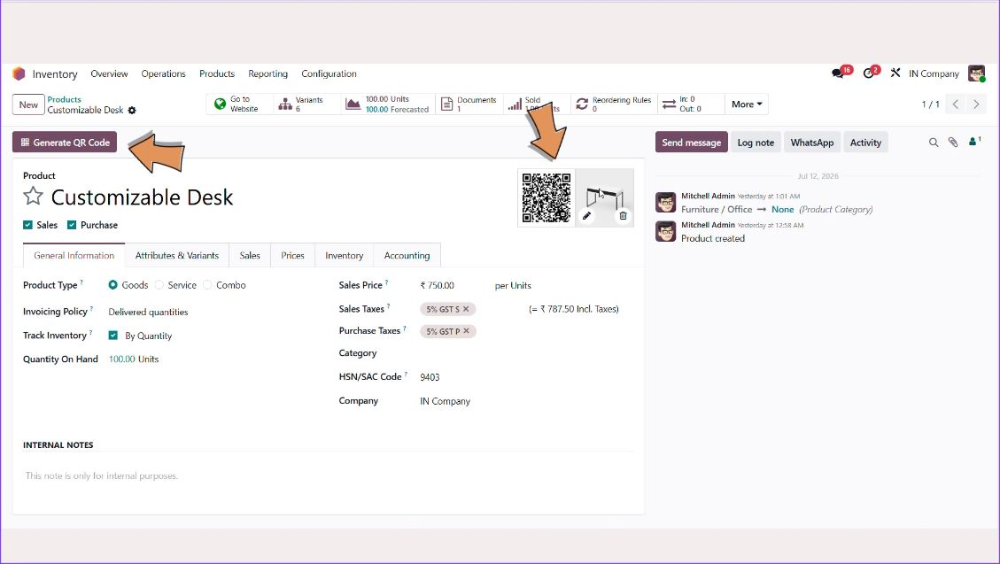
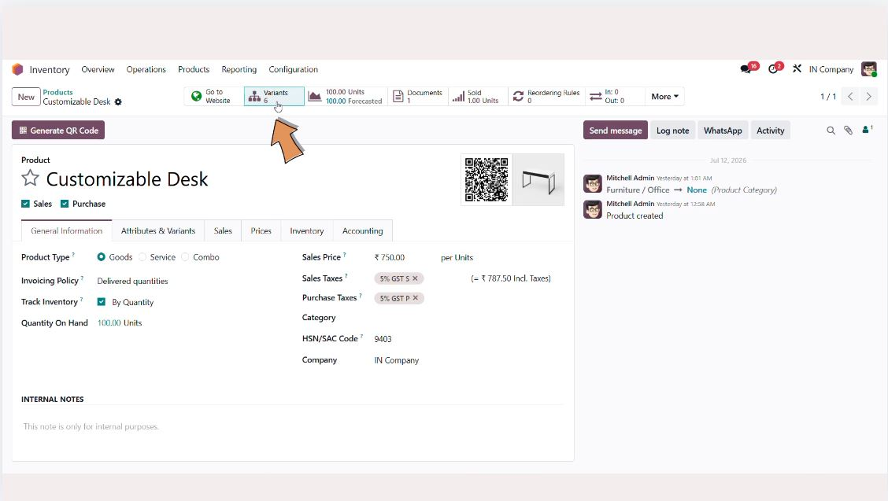
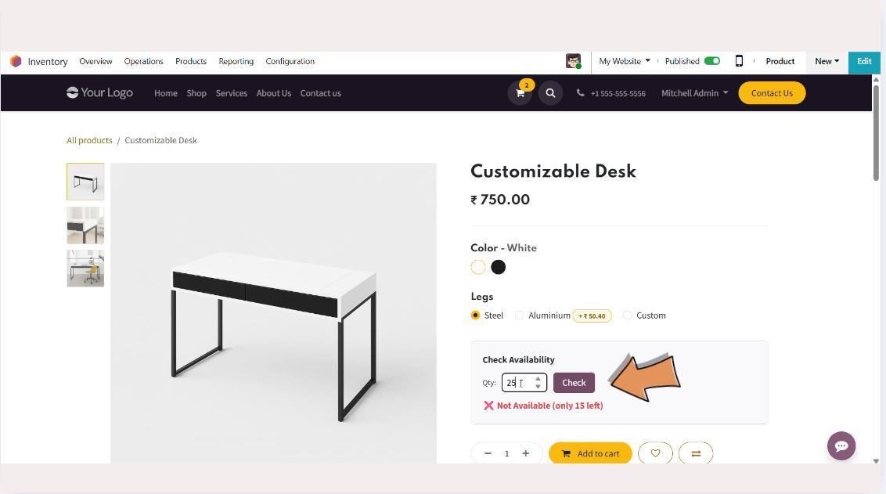
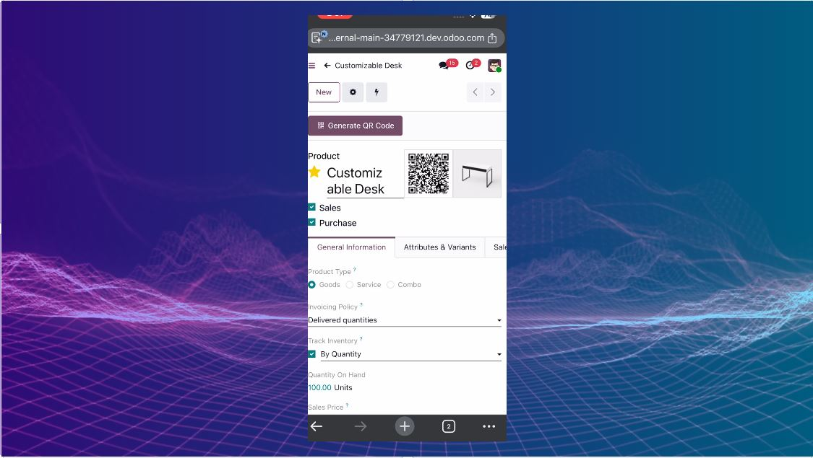

# Odoo Apps Collection


A collection of Odoo 19 custom modules for HR attendance automation, product QR access, and material quantity conversion.

This repository contains multiple independent Odoo add-ons designed to extend standard Odoo functionality for real-world business processes:

- Slack-based employee attendance tracking
- Product QR code generation and customer-facing stock availability
- CBM-to-pieces conversion for inventory and sales workflows

## Odoo App Store

- [Slack Attendance Integration](https://apps.odoo.com/apps/modules/19.0/slack_attendance_integration)
- [QR Code & Stock Availability Checker](https://apps.odoo.com/apps/modules/19.0/website_product_qr_portal)
- [CBM Converter](https://apps.odoo.com/apps/modules/19.0/cbm_converter)

## Screenshots

QR Code & Stock Availability Checker:

<p align="center">
  
  
</p>
<p align="center">
  
  
</p>

## Repository Overview

This project is built for Odoo 19 and is organized as a set of custom modules under a single repository.

### Included Modules

- `slack_attendance_integration`
  - Slack slash command based attendance check-in/check-out
  - Break tracking and working hour calculations
  - Slack webhook handling and employee mapping
  - Attendance configuration management

- `website_product_qr_portal`
  - Product QR code generation
  - Public product detail page for scanned QR codes
  - Customer stock availability checker on product pages

- `cbm_converter`
  - Converts CBM quantity to pieces for construction material-related workflows
  - Integrates with accounting, sales and stock models

## Tech Stack

- Odoo 19
- Python
- JavaScript (frontend asset for website availability checker)
- Slack slash commands and incoming webhooks
- qrcode / Pillow for QR generation
- certifi for HTTPS certificate validation

## Project Structure

```text
OdoosApps/
├── LICENSE
├── README.md
├── cbm_converter/
│   ├── __init__.py
│   ├── __manifest__.py
│   ├── models/
│   │   ├── __init__.py
│   │   ├── account_move_line.py
│   │   ├── sale_order_line.py
│   │   ├── stock_move_line.py
│   │   ├── stock_return_picking_line.py
│   │   └── utils.py
│   └── views/
│       └── cbm_views.xml
│
├── slack_attendance_integration/
│   ├── __init__.py
│   ├── __manifest__.py
│   ├── controllers/
│   │   ├── __init__.py
│   │   └── slack_webhook.py
│   ├── data/
│   │   └── ir_cron_data.xml
│   ├── models/
│   │   ├── __init__.py
│   │   ├── attendance_break.py
│   │   ├── hr_attendance.py
│   │   ├── hr_employee.py
│   │   └── slack_config.py
│   ├── security/
│   │   └── ir.model.access.csv
│   └── views/
│       ├── attendance_break_views.xml
│       ├── hr_attendance_views.xml
│       ├── hr_employee_views.xml
│       └── slack_config_views.xml
│
└── website_product_qr_portal/
    ├── README.md
    ├── __init__.py
    ├── __manifest__.py
    ├── controllers/
    │   ├── __init__.py
    │   └── product_qr.py
    ├── models/
    │   ├── __init__.py
    │   └── product_template.py
    ├── security/
    │   └── ir.model.access.csv
    ├── static/
    │   ├── description/
    │   └── src/
    │       └── js/
    │           └── check_availability.js
    └── views/
        ├── product_qr_portal.xml
        ├── product_template_views.xml
        └── website_sale_templates.xml
```

## Module 1: Slack Attendance Integration

### Purpose
This module allows employees to manage attendance using Slack slash commands instead of using the traditional Odoo attendance screens.

### Features
- Employee login via Slack command
- Employee logout via Slack command
- Break start and break resume handling
- Break exclusion logic for short breaks
- Attendance working hour calculation (total time minus counted breaks)
- Login grace minutes and minimum break threshold, configurable per Slack config record
- HMAC-SHA256 verification of Slack requests
- AI daily summaries (optional, Gemini or Claude)
- Per-employee timezone support
- Daily missed-logout alerts
- Webhook-based interaction with Slack

### Example Slack Commands
- `/login`
- `/logout`
- `/break`
- `/resume`

### Business Logic
- Employees are identified using their Slack user ID
- Each Slack user is mapped to an Odoo employee
- A configured webhook is used to send messages back to Slack
- Attendance entries track:
  - check-in
  - check-out
  - break entries
  - net worked hours
  - counted vs non-counted breaks

### Important Notes
- The module depends on Odoo HR and Attendance features
- This is designed for use in Odoo environments where Slack integration is required in a workplace attendance workflow
- HTTPS calls use `certifi` for certificate validation
- Slack requests are verified with HMAC-SHA256 signatures

## Module 2: Website Product QR Portal

### Purpose
This module creates a publicly accessible product page and QR code functionality for product lookup and quick stock checking.

### Features
- Generate QR codes for products from the product form
- QR code stores product reference information
- Public endpoint accessible without login
- Displays product details to the customer
- Adds stock availability checker on the website product page
- Supports quantity check before purchase

### Public Flow
1. User opens a product in Odoo
2. QR code is generated
3. Customer scans QR code
4. Public page opens with the product information
5. Customer can check quantity availability

### Dependencies
- `product`
- `website`
- `website_sale`
- Python package: `qrcode`
- Python package: `Pillow`

### Installation
Install the dependency:

```bash
pip install qrcode[pil]
```

## Module 3: CBM Converter

### Purpose
This module converts CBM (cubic meter / cubic volume) quantity into quantities expressed in pieces for materials that are managed in construction and inventory operations.

### Features
- CBM quantity conversion logic
- Integration with sales, stock, and accounting objects
- Custom conversion utility methods
- UI views for management

### Typical Use
Useful for businesses dealing with materials where product quantity is sometimes expressed as volume but needs to be converted to piece counts for order processing and accounting.

## Requirements

Before installing these modules, make sure your Odoo instance meets the following:

- Odoo 19 environment
- Appropriate custom addons path configured
- Internet access for Slack webhook interaction
- Python packages:
  - `qrcode`
  - `Pillow`
  - `certifi`
- HR attendance enabled
- Website module enabled for product QR portal

## Installation

### 1. Clone the repository
```bash
git clone https://github.com/anmol6213/OdoosApps.git
```

### 2. Add the modules to your Odoo addons path

Option A: point Odoo to the cloned folder:

```bash
./odoo-bin --addons-path=/path/to/odoo/addons,/path/to/OdoosApps
```

Option B: copy only the modules you need:

```bash
cp -r OdoosApps/slack_attendance_integration /path/to/custom_addons/
cp -r OdoosApps/website_product_qr_portal /path/to/custom_addons/
cp -r OdoosApps/cbm_converter /path/to/custom_addons/
```

### 3. Update apps list
In Odoo:
- Enable Developer Mode
- Go to Apps
- Click Update Apps List

### 4. Install modules
Search and install the required module(s) individually:
- Slack Attendance Integration
- QR Code & Stock Availability Checker
- CBM Converter

## Configuration

### Slack Attendance Integration
To use the module correctly:
1. Create and configure a Slack app with slash commands
2. Map each Slack user to an Odoo employee
3. Set the employee `slack_user_id`
4. Create a Slack config record with:
   - active flag
   - Slack Bot Token (`xoxb-...`)
   - Slack Signing Secret
   - webhook URL
   - login grace minutes
   - minimum break minutes
5. Ensure Odoo can reach the Slack webhook endpoint

> The bot token and signing secret are stored in Odoo password fields, never in the source code.

### Product QR Portal
For QR generation:
- Ensure the product has a valid barcode
- Install required Python dependency
- Enable website features in the Odoo instance

## Usage Examples

### Attendance
- Employee types `/login` in Slack
- Employee types `/break` when taking a break
- Employee types `/resume` after the break
- Employee types `/logout` when leaving work

### Product QR Access
- Open a product record
- Generate QR code
- Display or print the QR code
- Customer scans and views the product information on the public page

### CBM Conversion
- Use module logic in sales/stock workflows where quantity needs conversion from volume to units

## Security & Best Practices

- Slack requests are verified with HMAC-SHA256 signatures
- Bot token and signing secret are stored in Odoo password fields, never in the source code
- Use environment-specific secrets and webhook configuration
- Restrict access to employee and attendance data appropriately
- Regularly review break and attendance logic for business compliance

## Known Notes

- The attendance module is purpose-built for Odoo HR and Slack-based workflows
- Some logic is tailored to a specific business process and may need adaptation based on team policy
- The repo contains several independent add-ons, so not all modules need to be installed together

## License

This project is licensed under [LGPL-3.0](LICENSE) unless stated otherwise in a module-specific file.

## Author

- Anmol Patil ([GitHub](https://github.com/anmol6213))

## Contribution

Feel free to fork and extend this project for your own Odoo deployment needs. If you are using these modules in a production environment, it is recommended to validate all business rules against your internal HR and inventory policies.

## Summary

This repository bundles practical Odoo modules focused on:
- employee time tracking
- customer-facing product access
- operational material conversion

It is well-suited for businesses using Odoo with Slack and web-based product workflows.
